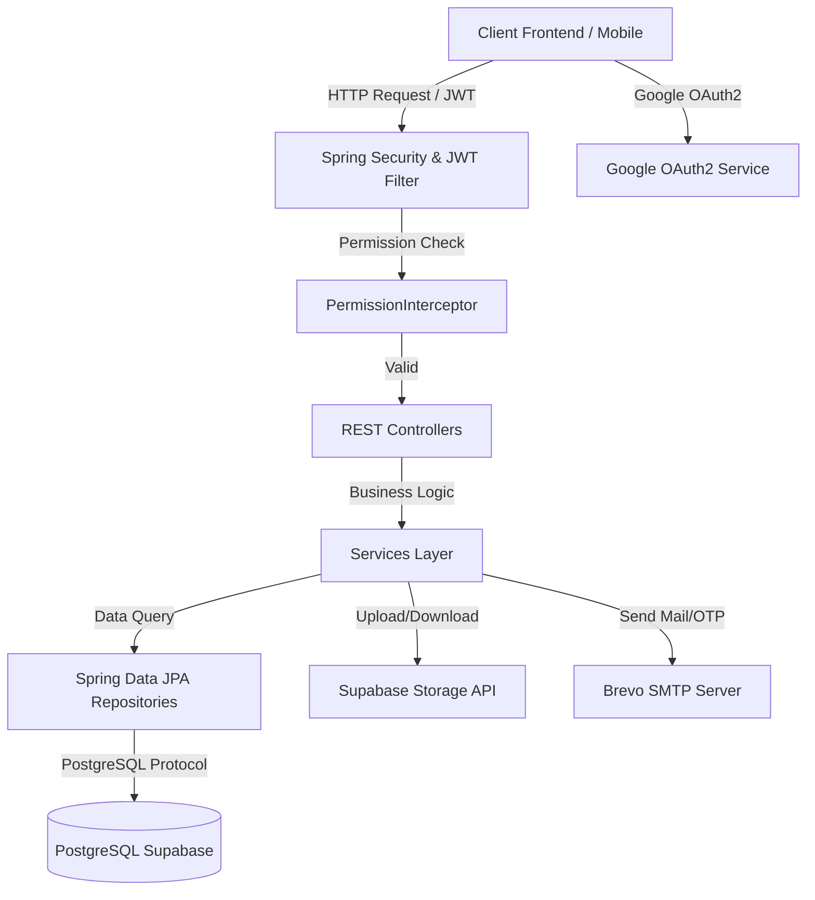

# 🚀 JobHunter Backend RESTful API

[](https://spring.io/projects/spring-boot)
[](https://www.oracle.com/java/)
[](https://supabase.com/)
[](https://spring.io/projects/spring-security)
[](#)

Hệ thống Backend RESTful API cho nền tảng tuyển dụng công việc **JobHunter**, được xây dựng bằng **Spring Boot 3.2**, **Java 17**, tích hợp **PostgreSQL (Supabase)**, hệ thống bảo mật **JWT + OAuth2 (Google Login)**, phân quyền động **RBAC (Role-Based Access Control)**, và gửi mail thông báo tự động.

---

## 📋 Mục lục

1. [Giới thiệu chung](#-giới-thiệu-chung)
2. [Công nghệ sử dụng](#-công-nghệ-sử-dụng)
3. [Tính năng chính](#-tính-năng-chính)
4. [Kiến trúc hệ thống & Bảo mật](#-kiến-trúc-hệ-thống--bảo-mật)
5. [Cấu trúc thư mục dự án](#-cấu-trúc-thư-mục-dự-án)
6. [Danh sách API Endpoints](#-danh-sách-api-endpoints)
7. [Cấu hình môi trường & BIến số](#-cấu-hình-môi-trường--biến-số)
8. [Hướng dẫn cài đặt & Chạy ứng dụng](#-hướng-dẫn-cài-đặt--chạy-ứng-dụng)
9. [Tài khoản khởi tạo mặc định](#-tài-khoản-khởi-tạo-mặc-định)

---

## 📖 Giới thiệu chung

**JobHunter Backend** đóng vai trò là API Server cung cấp toàn bộ logic xử lý dữ liệu cho ứng dụng tìm kiếm việc làm & quản lý tuyển dụng. Hệ thống hỗ trợ người tìm việc (Candidate), nhà tuyển dụng (Employer/HR) và quản trị viên (Super Admin) tương tác mượt mà qua giao diện REST API chuẩn hóa.

Dự án được tích hợp các công nghệ hiện đại như **Supabase Storage** quản lý tệp tin CV/hình ảnh, dịch vụ gửi Email thông báo tự động (Brevo SMTP), và đăng nhập nhanh bằng **Google OAuth2**.

---

## 🛠 Công nghệ sử dụng

* **Core Framework**: Java 17, Spring Boot 3.2.4
* **Build Tool**: Gradle (Kotlin DSL - `build.gradle.kts`)
* **Database & Persistence**:
  * PostgreSQL (Supabase Cloud Serverless DB)
  * Spring Data JPA / Hibernate ORM
  * `com.turkraft.springfilter`: Bộ lọc truy vấn động mạnh mẽ (Dynamic Filters & Search)
* **Security & Authentication**:
  * Spring Security 6
  * JSON Web Token (JWT) - Access Token & Refresh Token (HttpOnly Cookie)
  * OAuth2 Client (Google Social Login integration)
  * BCrypt Password Encoder
* **Third-party Integrations & Services**:
  * **Groq AI API** (`openai/gpt-oss-20b`): Hỗ trợ AI Chat & tư vấn nghề nghiệp
  * **Supabase Cloud Storage**: Lưu trữ CV (`.pdf`, `.doc`, `.docx`) và ảnh đại diện/logo
  * **Brevo (Sendinblue) / Spring Mail**: Gửi email xác thực OTP, quên mật khẩu và email thông báo việc làm mới cho Subscriber
  * **WebSocket / STOMP**: Hỗ trợ thông báo thời gian thực (Real-time notifications)
* **Lombok & Validation**: Spring Validation (`jakarta.validation`), Project Lombok

---

## ✨ Tính năng chính

### 1. 🔐 Quản lý Tài khoản & Bảo mật (Auth & Security)
* **Đăng ký & Đăng nhập**: Hỗ trợ đăng nhập mật khẩu và Google OAuth2.
* **Xác thực JWT Dual-Token**:
  * `access_token` trả về client để gửi kèm Authorization Header.
  * `refresh_token` tự động lưu vào HttpOnly Cookie bảo mật và lưu DB để cấp lại Token mới khi hết hạn.
* **Quên mật khẩu & Quản lý OTP**: Gửi mã OTP xác minh qua Email (Brevo SMTP) để đổi lại mật khẩu an toàn.

### 2. 🛡 Phân quyền Động theo Vai trò (RBAC)
* **Phân quyền linh hoạt**: Phân quyền chi tiết tới từng API URL + HTTP Method (`GET`, `POST`, `PUT`, `DELETE`).
* **Custom PermissionInterceptor**: Kiểm tra quyền truy cập của người dùng đối với endpoint trước khi xử lý request.
* **Database Initializer**: Tự động sinh danh sách Permissions và cấp quyền cho role `SUPER_ADMIN` khi chạy lần đầu.

### 3. 🏢 Quản lý Công ty (Company Management)
* Tạo, cập nhật, xóa và tìm kiếm danh sách công ty.
* Tích hợp upload logo và tài liệu công ty lên Supabase Storage.
* Hỗ trợ tìm kiếm phân trang và lọc dữ liệu đa tiêu chí.

### 4. 💼 Quản lý Việc làm & Kỹ năng (Jobs & Skills Catalog)
* Đăng tin tuyển dụng với chi tiết mức lương, vị trí, cấp bậc, địa điểm, mô tả công việc và danh sách kỹ năng yêu cầu.
* Lọc danh sách công việc công khai theo từ khóa, địa điểm, mức lương và kỹ năng.

### 5. 📄 Quản lý Hồ sơ Ứng tuyển (ATS / Resumes)
* Ung viên nộp CV (định dạng PDF, DOC, DOCX) trực tiếp cho vị trí tuyển dụng.
* Theo dõi trạng thái ứng tuyển: `PENDING`, `APPROVED`, `REJECTED`,...
* HR/Admin quản lý, duyệt hoặc từ chối hồ sơ xin việc của ứng viên.

### 6. 🔔 Đăng ký Nhận Tin tuyển dụng (Subscribers & Email Job Alerts)
* Ứng viên đăng ký nhận thông tin việc làm phù hợp theo danh sách kỹ năng mong muốn.
* Hệ thống tự động quét và gửi email thông báo định kỳ khi có công việc mới khớp với kỹ năng đã đăng ký.

### 7. 📁 Quản lý Upload File (Supabase Storage)
* Upload & Download file bảo mật lên Supabase Storage bucket.
* Kiểm tra và giới hạn định dạng file upload (`pdf`, `jpg`, `jpeg`, `png`, `doc`, `docx`) với kích thước tối đa 50MB.

---

## 📐 Kiến trúc hệ thống & Bảo mật



---

## 📂 Cấu trúc thư mục dự án

```text
src/main/java/vn/hoidanit/jobhunter/
├── config/                         # Các cấu hình hệ thống
│   ├── AppConfig.java              # RestTemplate & Bean Config
│   ├── CorsConfig.java             # Cấu hình CORS Cross-Origin
│   ├── DatabaseInitializer.java    # Khởi tạo dữ liệu Role, Permission, Admin ban đầu
│   ├── OAuth2LoginSuccessHandler.java # Xử lý Google OAuth2 đăng nhập thành công
│   ├── PermissionInterceptor.java  # Interceptor kiểm tra quyền động (RBAC)
│   ├── SecurityConfiguration.java  # Spring Security 6 & JWT Filter Chain
│   └── WebSocketConfig.java        # Cấu hình STOMP / WebSocket
├── controller/                     # REST API Controllers (V1)
│   ├── AuthController.java         # Auth, Login, Logout, Register, OTP, Reset Pass
│   ├── CompanyController.java      # CRUD Công ty
│   ├── FileController.java         # Upload/Download File qua Supabase
│   ├── JobController.java          # CRUD Việc làm
│   ├── ResumeController.java       # CRUD & Duyệt hồ sơ ứng tuyển (CV)
│   ├── SkillController.java        # Quản lý danh mục Kỹ năng
│   ├── SubscriberController.java   # Đăng ký nhận thông báo việc làm
│   └── UserController.java         # Quản lý Người dùng
├── domain/                         # JPA Entities & DTOs
│   ├── request/                    # Request Body DTOs
│   └── response/                   # Response Output DTOs & Wrapper
├── repository/                     # Spring Data JPA Interfaces
├── service/                        # Business Logic implementation
└── util/                           # Utilities & Custom Annotations
    ├── SecurityUtil.java           # JWT generator & Spring Security Context Helper
    └── error/                      # Custom Exceptions & Global Exception Handler
```

---

## 🔌 Danh sách API Endpoints chính

### 1. Authentication & Account (`/api/v1/auth`)
| Method | Endpoint | Mô tả | Quyền truy cập |
| :--- | :--- | :--- | :--- |
| `POST` | `/api/v1/auth/login` | Đăng nhập hệ thống (Lấy Access Token & Cookie Refresh Token) | Public |
| `GET` | `/api/v1/auth/account` | Lấy thông tin tài khoản hiện tại | Authenticated |
| `GET` | `/api/v1/auth/refresh` | Cấp lại Access Token mới bằng Refresh Token | Public (Cookie) |
| `POST` | `/api/v1/auth/logout` | Đăng xuất tài khoản và xóa Cookie | Authenticated |
| `POST` | `/api/v1/auth/register` | Đăng ký tài khoản người dùng mới | Public |
| `POST` | `/api/v1/auth/forgot-password` | Gửi mã OTP khôi phục mật khẩu qua Email | Public |
| `POST` | `/api/v1/auth/verify-otp` | Xác minh mã OTP | Public |
| `POST` | `/api/v1/auth/reset-password` | Đặt lại mật khẩu mới | Public |

### 2. Việc làm (`/api/v1/jobs`) & Công ty (`/api/v1/companies`)
| Method | Endpoint | Mô tả | Quyền truy cập |
| :--- | :--- | :--- | :--- |
| `GET` | `/api/v1/jobs` | Lấy danh sách việc làm (có phân trang & bộ lọc) | Public |
| `GET` | `/api/v1/jobs/{id}` | Lấy chi tiết việc làm theo ID | Public |
| `POST` | `/api/v1/jobs` | Tạo việc làm mới | RBAC Permission |
| `PUT` | `/api/v1/jobs` | Cập nhật thông tin việc làm | RBAC Permission |
| `DELETE` | `/api/v1/jobs/{id}` | Xóa việc làm | RBAC Permission |
| `GET` | `/api/v1/companies` | Lấy danh sách công ty | Public |
| `GET` | `/api/v1/companies/{id}` | Lấy chi tiết công ty theo ID | Public |

### 3. Hồ sơ ứng tuyển ATS (`/api/v1/resumes`)
| Method | Endpoint | Mô tả | Quyền truy cập |
| :--- | :--- | :--- | :--- |
| `POST` | `/api/v1/resumes` | Nộp hồ sơ ứng tuyển CV | RBAC Permission |
| `PUT` | `/api/v1/resumes` | Cập nhật trạng thái hồ sơ (APPROVED, REJECTED,...) | RBAC Permission |
| `GET` | `/api/v1/resumes/{id}` | Lấy chi tiết hồ sơ | RBAC Permission |
| `GET` | `/api/v1/resumes` | Lấy danh sách hồ sơ ứng tuyển | RBAC Permission |

### 4. Upload File (`/api/v1/files`)
| Method | Endpoint | Mô tả | Quyền truy cập |
| :--- | :--- | :--- | :--- |
| `POST` | `/api/v1/files` | Upload file (CV, Logo, Image) lên Supabase Storage | Authenticated |
| `GET` | `/api/v1/files` | Download file theo URL | Public |

---

## ⚙️ Cấu hình môi trường & Biến số

Tạo hoặc cập nhật cấu hình trong file [`src/main/resources/application.properties`](file:///c:/Users/ADMIN/javaSpring/01-java-spring-jobhunter-starter-master/src/main/resources/application.properties):

```properties
spring.application.name=jobhunter

# Database Configuration (PostgreSQL / Supabase)
spring.datasource.url=jdbc:postgresql://<HOST>:<PORT>/<DATABASE>?prepareThreshold=0
spring.datasource.username=<DATABASE_USERNAME>
spring.datasource.password=<DATABASE_PASSWORD>
spring.datasource.driver-class-name=org.postgresql.Driver
spring.jpa.hibernate.ddl-auto=update
spring.jpa.properties.hibernate.dialect=org.hibernate.dialect.PostgreSQLDialect

# JWT Configuration
jwt.base64-secret=<YOUR_BASE64_JWT_SECRET_KEY>
jwt.access-token-validity-in-seconds=86400
jwt.refresh-token-validity-in-seconds=864000

# Supabase Storage Configuration
supabase.url=https://<SUPABASE_PROJECT_ID>.supabase.co
supabase.key=<SUPABASE_ANON_KEY>

# Brevo Mail SMTP Configuration
spring.mail.host=smtp-relay.brevo.com
spring.mail.port=2525
spring.mail.username=<BREVO_SMTP_USERNAME>
spring.mail.password=${SPRING_MAIL_PASSWORD}

# Google OAuth2 Credentials
spring.security.oauth2.client.registration.google.client-id=${GOOGLE_CLIENT_ID}
spring.security.oauth2.client.registration.google.client-secret=${GOOGLE_CLIENT_SECRET}
spring.security.oauth2.client.registration.google.scope=email,profile
```

---

## 🚀 Hướng dẫn cài đặt & Chạy ứng dụng

### Yêu cầu tiên quyết
* **Java**: JDK 17 trở lên
* **Gradle**: 8.x (hoặc dùng Gradle Wrapper đi kèm `./gradlew`)
* **Database**: PostgreSQL (hoặc tài khoản Cloud PostgreSQL Supabase)

### Các bước khởi chạy

1. **Clone repository về máy**:
   ```bash
   git clone https://github.com/QThang2006/Jobhunter_backend.git
   cd Jobhunter_backend
   ```

2. **Thiết lập biến môi trường** (hoặc cấu hình trực tiếp trong `application.properties`):
   ```bash
   export SPRING_MAIL_PASSWORD="your_brevo_smtp_password"
   export GOOGLE_CLIENT_ID="your_google_client_id"
   export GOOGLE_CLIENT_SECRET="your_google_client_secret"
   ```

3. **Build dự án bằng Gradle**:
   ```bash
   ./gradlew clean build -x test
   ```

4. **Khởi chạy ứng dụng Spring Boot**:
   ```bash
   ./gradlew bootRun
   ```

Ứng dụng sẽ chạy tại địa chỉ: `http://localhost:8080`

---

## 👤 Tài khoản khởi tạo mặc định

Khi ứng dụng khởi chạy lần đầu tiên, `DatabaseInitializer` sẽ tự động tạo dữ liệu mẫu bao gồm danh sách Permissions, Role `SUPER_ADMIN` và tài khoản Admin mặc định:

* **Email**: `admin@gmail.com`
* **Mật khẩu**: `123456`
* **Quyền hạn**: `SUPER_ADMIN` (Toàn quyền truy cập tất cả các Endpoints API)

---

## 🤝 Đóng góp & Giấy phép

Dự án phát triển bởi **QThang2006** dưới sự hỗ trợ cấu trúc từ khóa học Java Spring Boot HoiDanIT.
Giấy phép mở **MIT License**.
