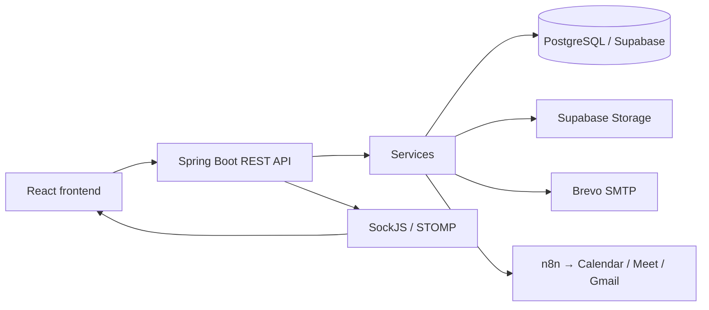

# BakeJobs - Backend REST API

Backend của **BakeJobs**, nền tảng tuyển dụng cho tiệm bánh/F&B, xử lý hồ sơ ứng tuyển, lịch phỏng vấn, thông báo và phân ca nhân viên. Tên repository `Jobhunter_backend` và package `vn.hoidanit.jobhunter` được giữ lại từ dự án nền tảng.

Source sử dụng **Java 17, Spring Boot 3.2.4 và PostgreSQL trên Supabase**. Xem [README frontend](https://github.com/QThang2006/Jobhunter_FE/blob/main/README.md) để chạy giao diện. Tài liệu mô tả chức năng đang có cùng các lỗi đã biết, không khẳng định hệ thống đã hoàn thiện bảo mật hay kiểm thử production.

## Công nghệ và kiến trúc

| Thành phần | Công nghệ / chức năng |
|---|---|
| API | Spring Web, Validation, Lombok |
| Build | Gradle Wrapper, Kotlin DSL |
| Dữ liệu | PostgreSQL, Spring Data JPA/Hibernate, Spring Filter JPA 3.1.7 |
| Xác thực | Spring Security, JWT HS512, BCrypt, OAuth2 Google |
| File | Supabase Storage, CV và hình ảnh |
| Email | JavaMail, Thymeleaf, Brevo SMTP cổng 2525 |
| Kiểm tra email | Abstract API |
| Thời gian thực | SockJS/STOMP, thông báo và sự kiện tải lại dữ liệu |
| Phỏng vấn online | Webhook n8n, Google Calendar/Meet, Gmail |



REST đi qua Spring Security. `PermissionInterceptor` kiểm tra quyền URL + method cho API quản trị; API public và API tự phục vụ có phạm vi riêng. Các thao tác tuyển dụng/phân ca còn kiểm tra công ty sở hữu dữ liệu. Quản trị tài khoản người khác yêu cầu `SUPER_ADMIN`; sửa hồ sơ cá nhân dùng `/users/me`. Source chưa có controller/service chat AI hoặc tích hợp Groq như README cũ mô tả.

## Nghiệp vụ

### Tài khoản và ứng tuyển

- Đăng ký tạo tài khoản; frontend chuyển về đăng nhập. Đăng ký không trả JWT để đăng nhập ngay.
- Đăng nhập trả access token và refresh cookie HttpOnly. Refresh token được lưu vào database để đối chiếu; mỗi lần refresh tạo token mới và trả đúng token đó trong cookie `Secure; HttpOnly; SameSite=None` khi deploy HTTPS.
- Có Google OAuth2, quên mật khẩu qua OTP, xác minh OTP, đặt lại và đổi mật khẩu.
- Người đã đăng nhập nộp hồ sơ qua `POST /api/v1/resumes`.
- Khách ứng tuyển nhanh qua `POST /api/v1/resumes/quick-apply`. Backend chuẩn hóa email, tìm user hoặc tạo user mới rồi gửi mật khẩu tạm. Role `USER` được seed và dùng mặc định; thông tin role/company từ request đăng ký bị bỏ qua.

### Phỏng vấn và kết quả tuyển dụng

| Trạng thái hồ sơ | Ý nghĩa / xử lý |
|---|---|
| `PENDING` | Hồ sơ mới, chờ xem xét |
| `REVIEWING` | Đang xem xét/phỏng vấn; luồng hẹn phỏng vấn lưu ngày, giờ, hình thức và ghi chú |
| `APPROVED` | Nhận ứng viên, gắn user vào công ty của job, xóa trường lịch phỏng vấn, gửi email nhận việc và thông báo |
| `REJECTED` | Từ chối, xóa trường lịch phỏng vấn và gửi email từ chối |

`POST /api/v1/email/approve` và alias `/api/v1/email/schedule-interview` cùng xử lý hẹn phỏng vấn và đặt trạng thái `REVIEWING`. Tên endpoint `/approve` là tên cũ, không có nghĩa chuyển hồ sơ sang `APPROVED`.

Với `ONLINE_MEET`, backend gọi webhook n8n để tạo lịch Google Calendar/Meet, gửi Gmail và trả link Meet để lưu vào hồ sơ. Nếu không lấy được link, có nhánh gửi thư mời trực tiếp bằng SMTP. Với `OFFLINE`, backend gửi thư mời qua SMTP.

### Phân ca và thông báo

- `WorkShift` liên kết nhân viên, công ty và job tùy chọn. Trạng thái: `ASSIGNED`, `CONFIRMED`, `COMPLETED`, `TRANSFERRED`, `CANCELLED`.
- Có tạo, sửa, xóa, xem ca, lấy ca cá nhân và danh sách nhân viên dạng DTO tối thiểu. Kiểm tra nhân viên/job cùng công ty và giờ trùng, kể cả ca qua đêm; khóa nhân viên trong transaction để tránh phân ca trùng đồng thời. Chuyển ca cập nhật người nhận/ngày trên bản ghi hiện tại, thêm lịch sử vào note.
- `Notification` lưu trong database, hỗ trợ đếm chưa đọc và đánh dấu đã đọc.
- SockJS endpoint `/ws` phát STOMP marker như `REFRESH`, `NEW_NOTIFICATION`; frontend nhận marker rồi gọi REST để tải dữ liệu. Có topic cho users, roles, permissions, companies, jobs, skills, resumes, shifts và các topic theo user. Đây là cơ chế cập nhật dữ liệu/thông báo.

### Email việc làm và file

Subscriber đăng ký kỹ năng để nhận việc phù hợp. **Gửi email được kích hoạt bởi `GET /api/v1/email`**, hiện chưa có scheduler gửi định kỳ. Tác vụ `@Scheduled` hiện có dùng để dọn OTP, chu kỳ 60 giây.

`POST /api/v1/files` nhận multipart `file` và `folder` (frontend dùng bucket `resume` hoặc `company`). `data.fileName` trả URL public đầy đủ. Extension được cho phép: `pdf`, `jpg`, `jpeg`, `png`, `doc`, `docx`; cấu hình giới hạn file/request 50 MB. `GET /api/v1/files?fileUrl=...` tải file theo URL. Ứng tuyển khách vẫn được upload CV vào bucket `resume`. Upload vào `company` yêu cầu quyền quản lý công ty. Download chỉ nhận HTTPS URL public của bucket `resume`/`company` trên đúng Supabase project, không theo redirect và có timeout.

## Mô hình dữ liệu và cấu trúc

| Entity | Quan hệ chính |
|---|---|
| `User` | Thuộc `Role`, có thể thuộc `Company` |
| `Company` | Có users và jobs |
| `Job` | Thuộc company, nhiều skills |
| `Skill` | Dùng cho jobs và subscribers |
| `Resume` | Liên kết user/job, lưu trạng thái và lịch phỏng vấn |
| `Role`, `Permission` | Quan hệ nhiều-nhiều; permission có URL, method, module |
| `Subscriber` | Email đăng ký và danh sách skills |
| `Notification` | Thuộc user, có thể liên kết resume |
| `WorkShift` | Thuộc user/company, job tùy chọn |

```text
src/main/java/vn/hoidanit/jobhunter/
├── config/       # Security, CORS, OAuth2, WebSocket, khởi tạo dữ liệu
├── controller/   # REST endpoints
├── domain/       # Entities, request/response DTOs
├── repository/   # Spring Data JPA
├── service/      # Nghiệp vụ và tích hợp dịch vụ ngoài
└── util/         # JWT, constants, annotations, xử lý lỗi
src/main/resources/
├── application.properties
└── templates/    # Thymeleaf email
src/test/         # Hiện có contextLoads
```

Schema hiện được Hibernate cập nhật bằng `spring.jpa.hibernate.ddl-auto=update`; chưa có bộ migration có version trong source.

## API hiện có

Các path trong bảng có prefix `/api/v1`. Bảng liệt kê mapping trong controller, không bảo đảm từng endpoint đã được phân quyền đầy đủ.

| Method | Path | Chức năng |
|---|---|---|
| POST | `/auth/login`, `/auth/register`, `/auth/logout` | Đăng nhập, đăng ký, đăng xuất |
| GET | `/auth/account`, `/auth/refresh` | Lấy tài khoản / cấp lại token |
| POST | `/auth/forgot-password`, `/auth/verify-otp`, `/auth/reset-password` | Khôi phục mật khẩu |
| GET | `/users`, `/users/{id}` | Danh sách / chi tiết user |
| POST, PUT | `/users` | Tạo / sửa user |
| DELETE | `/users/{id}` | Xóa user, trả HTTP 204 |
| GET, PUT | `/users/me` | Xem / sửa hồ sơ cá nhân, không đổi role/company/email |
| POST | `/users/change-password` | Đổi mật khẩu |
| GET | `/companies`, `/companies/{id}`, `/companies/by-user` | Tra cứu công ty |
| POST, PUT | `/companies` | Tạo / sửa công ty |
| DELETE | `/companies/{id}` | Xóa công ty |
| GET | `/jobs`, `/jobs/{id}`, `/jobs/by-company` | Tra cứu tin tuyển dụng |
| POST, PUT | `/jobs` | Tạo / sửa tin |
| DELETE | `/jobs/{id}` | Xóa tin |
| PATCH | `/jobs/{id}/active?status=true` | Bật/tắt tin bằng query `status` |
| GET, POST, PUT | `/skills` | Danh sách / tạo / sửa kỹ năng |
| DELETE | `/skills/{id}` | Xóa kỹ năng |
| POST | `/resumes`, `/resumes/quick-apply` | Nộp hồ sơ / ứng tuyển nhanh |
| GET | `/resumes`, `/resumes/{id}` | Danh sách / chi tiết hồ sơ |
| POST | `/resumes/by-user` | Hồ sơ của tài khoản hiện tại |
| PUT | `/resumes` | Cập nhật hồ sơ/trạng thái |
| DELETE | `/resumes/{id}` | Xóa hồ sơ |
| GET | `/email` | Kích hoạt gửi email việc làm |
| POST | `/email/approve`, `/email/schedule-interview` | Hai alias hẹn phỏng vấn |
| POST, PUT | `/subscribers` | Tạo / cập nhật đăng ký nhận tin |
| POST | `/subscribers/skills` | Lấy đăng ký kỹ năng của tài khoản |
| GET, POST, PUT | `/permissions` | Danh sách / tạo / sửa quyền |
| DELETE | `/permissions/{id}` | Xóa quyền |
| GET, POST, PUT | `/roles` | Danh sách / tạo / sửa vai trò |
| GET, DELETE | `/roles/{id}` | Chi tiết / xóa vai trò |
| GET | `/notifications`, `/notifications/unread-count` | Thông báo / số chưa đọc |
| PUT | `/notifications/{id}/read`, `/notifications/read-all` | Đánh dấu đã đọc |
| GET, POST | `/shifts` | Danh sách / tạo ca |
| GET, PUT, DELETE | `/shifts/{id}` | Chi tiết / sửa / xóa ca |
| POST | `/shifts/transfer` | Chuyển ca |
| GET | `/shifts/my-shifts`, `/shifts/employees` | Ca cá nhân / danh sách nhân viên |
| POST, GET | `/files` | Upload / download |

Chưa có GET chi tiết skill/permission hay API liệt kê, lấy chi tiết, xóa subscriber trong controller, dù frontend có thể khai báo API helper tương ứng.

Ngoài prefix API: `GET`/`HEAD /` trả health response `OK`; Google login bắt đầu ở `/oauth2/authorization/google`, callback tại `/login/oauth2/code/google`; SockJS tại `/ws`.

Response thông thường được bọc thành `{statusCode, error, message, data}`. Response dạng string hoặc Resource không đi qua wrapper này. Danh sách phân trang có `data.meta` (`page`, `pageSize`, `pages`, `total`) và `data.result`. Trang bắt đầu từ 1; dùng `page`, `size`, `sort=field,desc`, và `filter` ở endpoint hỗ trợ Spring Filter.

## Cấu hình và chạy local

Cần **JDK 17**, PostgreSQL và kết nối tới các dịch vụ được sử dụng. Dùng Gradle Wrapper đi kèm, không bắt buộc cài Gradle riêng. Chạy các lệnh sau tại `Jobhunter_backend`.

[application.properties](src/main/resources/application.properties) đọc thông tin database, JWT, Supabase và SMTP qua environment. Danh sách biến bắt buộc và thứ tự deploy nằm trong [DEPLOYMENT.md](DEPLOYMENT.md). Không commit secret thật. Spring Boot không tự nạp file `.env` như Vite.

Các placeholder cần cung cấp bằng environment/IDE:

```bash
export GOOGLE_CLIENT_ID='<google-client-id>'
export GOOGLE_CLIENT_SECRET='<google-client-secret>'
export N8N_INTERVIEW_MEET_WEBHOOK='https://<n8n-host>/webhook/<workflow-path>'
export SPRING_MAIL_PASSWORD='<brevo-smtp-password>'
export SPRING_MAIL_USERNAME='<brevo-smtp-user>'
```

Tạo file cấu hình riêng **ngoài repository**, ví dụ `/absolute/path/bakejobs-local.properties`, thay mọi placeholder bằng cấu hình của bạn:

```properties
spring.datasource.url=jdbc:postgresql://<host>:<port>/<database>?prepareThreshold=0
spring.datasource.username=<database-user>
spring.datasource.password=<database-password>
supabase.url=https://<project-id>.supabase.co
supabase.key=<storage-api-key-with-required-permissions>
spring.mail.username=<brevo-smtp-user>
jwt.base64-secret=<base64-encoded-random-key-at-least-64-bytes>
# Vi du thoi han ngan hon cho moi truong rieng:
jwt.access-token-validity-in-seconds=900
jwt.refresh-token-validity-in-seconds=604800
```

```bash
./gradlew bootRun --args='--spring.config.additional-location=file:/absolute/path/bakejobs-local.properties'
```

Ứng dụng mặc định chạy tại [http://localhost:8080](http://localhost:8080). Giá trị JWT **trong source hiện tại** là `8640000` giây cho cả access và refresh token (100 ngày); giá trị 900/604800 ở ví dụ là override đề xuất, không phải cấu hình đang có.

Có thể dùng environment để override các cấu hình phổ biến: `SPRING_DATASOURCE_URL`, `SPRING_DATASOURCE_USERNAME`, `SPRING_DATASOURCE_PASSWORD`, `SUPABASE_URL`, `SUPABASE_KEY`, `SPRING_MAIL_USERNAME`. Supabase cần các bucket tương ứng; code hiện trả URL public nên chính sách bucket phải phù hợp với cách tải file này.

Google Console cần redirect URI trỏ về `/login/oauth2/code/google` của backend. Đặt `FRONTEND_URL` để chọn frontend redirect, `CORS_ALLOWED_ORIGINS` để cho phép đúng origin. Local HTTP dùng `AUTH_COOKIE_SECURE=false`; production HTTPS giữ `true`.

### Cấu hình n8n

1. Import [workflow phỏng vấn](https://github.com/QThang2006/Jobhunter_FE/blob/main/src/resources/n8n/n8n-interview-meet-workflow.json) vào n8n.
2. Thiết lập Google credentials cho Calendar và Gmail, cùng calendar/tài khoản gửi phù hợp.
3. Kiểm tra múi giờ `Asia/Ho_Chi_Minh`; workflow mẫu tạo lịch dài 45 phút.
4. Kích hoạt workflow và gán URL webhook production vào `N8N_INTERVIEW_MEET_WEBHOOK` trước khi chạy backend.
5. Thử hẹn phỏng vấn `ONLINE_MEET`, kiểm tra event, email và `meetLink` trả về.

Bản export lưu `active: false`; đây là trạng thái file export, không xác nhận trạng thái workflow đang chạy trên máy chủ. Nhánh fallback SMTP không bảo đảm có link Meet.

## Khởi tạo dữ liệu, build và kiểm thử

[DatabaseInitializer](src/main/java/vn/hoidanit/jobhunter/config/DatabaseInitializer.java) seed permissions và `SUPER_ADMIN` cho database trống, bổ sung `USER`, gán role này cho tài khoản chưa có role, đồng bộ permissions cho `SUPER_ADMIN`. Role HR tùy chỉnh phải được cấp permissions tuyển dụng/phân ca cần thiết và gắn với công ty.

Database trống chỉ tạo `admin@gmail.com` khi có `BOOTSTRAP_ADMIN_PASSWORD`; không còn mật khẩu admin cố định trong source. Khi khởi động còn có bước dọn lịch phỏng vấn của hồ sơ `APPROVED`/`REJECTED`.

```bash
./gradlew test
./gradlew bootJar
```

Tests dùng profile `test` với H2 trong bộ nhớ và cấu hình thử riêng; không cần truy cập database production. Bao gồm khởi động context, kiểm tra API phân quyền/hồ sơ cá nhân, đăng ký không nâng quyền, dữ liệu nhân viên, CORS, token/cookie, OTP, tải file, hồ sơ trùng và ca làm qua đêm. Test gọi nghiệp vụ gửi mail dùng mock.

[Dockerfile](Dockerfile) dùng Gradle 8.7/JDK 17 để chạy `clean bootJar`, rồi Temurin 17 JRE chạy executable JAR. Chỉ tạo boot JAR để tránh wildcard COPY lấy cả plain JAR. Docker build không chạy test; cần chạy `./gradlew test` trước deploy.

## Các lỗi đã sửa và giới hạn còn lại

- Khôi phục kiểm tra quyền API quản trị, giới hạn dữ liệu theo công ty; tách quyền sửa hồ sơ cá nhân khỏi đổi role/company và chặn tự nâng quyền khi đăng ký.
- Ẩn password/refresh token/OTP khi serialize user; danh sách nhân viên dùng DTO tối thiểu.
- Bỏ secret khỏi source; refresh trả cookie token mới, phân biệt access/refresh token và thống nhất cookie OAuth. Token cũ có thể bị vô hiệu khi đổi JWT secret.
- Giới hạn tải file về đúng Supabase project, kiểm tra bucket upload; xác thực và kiểm tra topic STOMP, chặn client phát thông báo giả.
- Sửa cập nhật mô tả job, CORS PATCH, role mặc định, company trong account API, validation email, binding xóa user và lưu các trường hồ sơ cá nhân.
- Kiểm tra hạn OTP tại thời điểm xác minh; đổi mật khẩu lưu hash mới và thu hồi refresh token. Nộp CV dùng user hiện tại, luôn bắt đầu ở `PENDING`, kiểm tra thời gian tuyển và trùng hồ sơ.
- Ca làm kiểm tra công ty và trùng giờ. Lỗi quyền/not-found trả đúng HTTP 403/404. Chi tiết thay đổi frontend nằm trong README frontend.

Các kiểm thử này không thay thế kiểm tra Google OAuth, Supabase PostgreSQL, SMTP, n8n/Meet và cookie trình duyệt trên môi trường thật. H2 không mô phỏng đầy đủ hành vi/khóa của PostgreSQL. Public quick-apply/upload vẫn cần rate limiting và chính sách lưu trữ phù hợp trước khi mở rộng lưu lượng. CV hiện dùng URL public; chuyển sang file private/signed URL là thay đổi thiết kế riêng. Secret từng commit vẫn tồn tại trong lịch sử Git, cần thay credential tại nhà cung cấp.

## Nguồn gốc

Phát triển bởi **Ngô Quốc Thắng / QThang2006**, dựa trên cấu trúc khóa học Spring Boot RESTful API của [Hỏi Dân IT](https://www.youtube.com/@hoiDanIT). Chưa có file LICENSE trong source được đối chiếu nên tài liệu không khẳng định giấy phép MIT.
